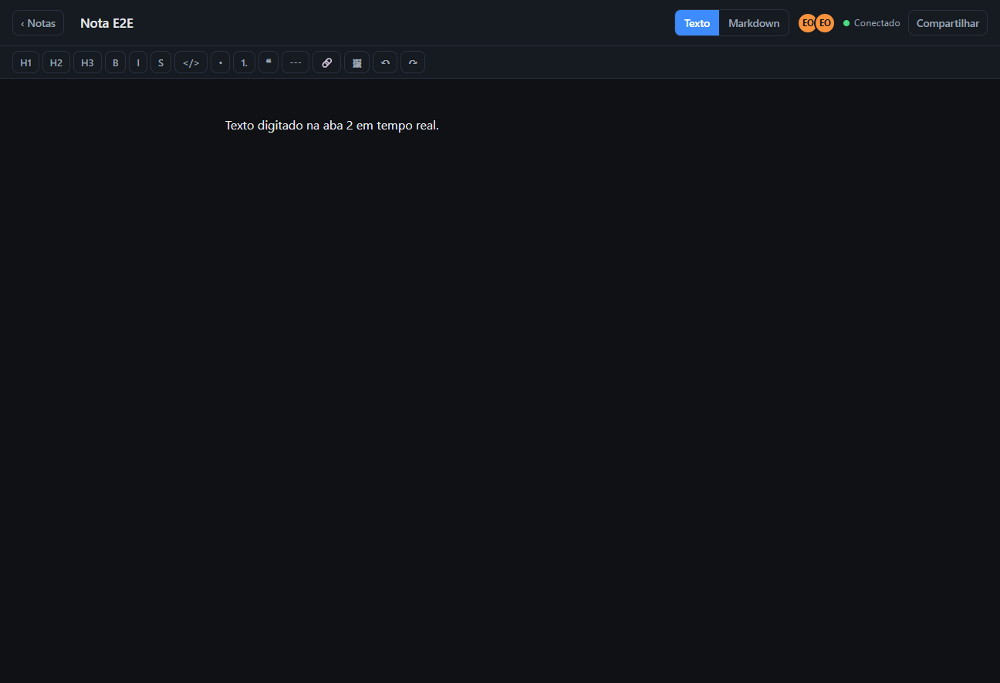
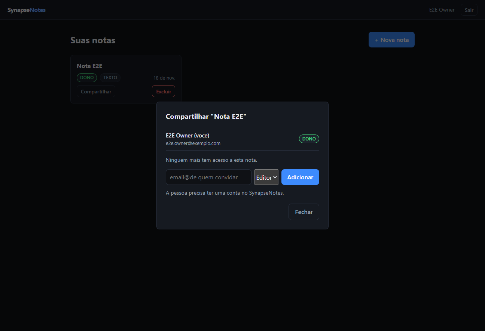

# SynapseNotes

Real-time collaborative notes on the edge: rich text and Markdown in one document, many cursors. A full-stack TypeScript monorepo running on Cloudflare Workers, Durable Objects and D1.

**Live demo:** https://synapsenotes.renato-aparecido-business.workers.dev



## Features

- **Real-time collaboration** — every note is a Yjs CRDT document hosted by its own Durable Object. Multiple people edit simultaneously with live presence and carets over a custom binary WebSocket protocol (`0x01` sync / `0x02` awareness / `0x03` control).
- **Rich text ⇄ Markdown** — switch any note between a TipTap rich editor and a CodeMirror Markdown editor. The content converts in both directions, the new mode is persisted server-side, and the change is broadcast live to everyone already in the note.
- **Accounts and sessions** — register, login and logout with PBKDF2-SHA256 (100k iterations) password hashing and a `HttpOnly; Secure; SameSite=Lax` session cookie with a 7-day TTL.
- **Sharing by e-mail** — invite any existing user as `editor` or `viewer`. Roles are enforced on the server: viewers receive the document live, but their sync frames are dropped by the Durable Object.
- **Hardened defaults** — origin allow-list for mutations, rate limits (auth 10/min, writes 30/min), per-room client caps and message-size limits.
- **One deploy for everything** — the Worker serves the JSON API, the WebSocket and the built SPA (Workers Assets) from a single URL.



## Stack

| Layer | Choice |
| --- | --- |
| Runtime | Cloudflare Workers, Durable Objects (SQLite-backed, WebSocket hibernation), D1, Workers Assets |
| Realtime | Yjs + y-protocols over custom binary frames, one `NoteRoom` Durable Object per note |
| Web | React 19, Vite 8, TipTap 3 (rich text), CodeMirror 6 (Markdown) |
| Shared | `@synapsenotes/shared` — route contracts, validation, wire protocol used by both sides |
| Tooling | npm workspaces, TypeScript (strict), `node --test`, dependency-free lint script |

The full design lives in [docs/ARCHITECTURE.md](docs/ARCHITECTURE.md).

## Getting started

**Prerequisites:** Node.js >= 22.13 (Node 24 recommended), npm, a free Cloudflare account, and `npx wrangler login` once.

```sh
git clone https://github.com/Renato1909/SynapseNotes.git
cd SynapseNotes
npm install
npm run db:migrate:local   # first run: create the local D1 schema
npm run dev                # Worker on :8787, web app on :5173
```

Open http://localhost:5173 and create an account.

### Known issue: `workerd` crashes on some Windows 11 machines

`wrangler dev` spawns a local `workerd` process. On some Windows 11 machines that process crashes at startup (`structured exception #0xc0000005` / *thread 'main' has overflowed its stack*) with any configuration. It is an upstream bug — [cloudflare/workerd#4668](https://github.com/cloudflare/workerd/issues/4668) — unrelated to this project. Workarounds:

1. **Run the stack inside WSL2** — `npm run dev` works normally there.
2. **Develop against the deployed Worker** (no local `workerd` involved):

   ```sh
   # terminal 1 — publish server changes
   npm run build
   npm run deploy -w @synapsenotes/server

   # terminal 2 — web dev server proxying /api and /collab to the deploy
   $env:SYNAPSE_PROXY_TARGET='https://<your-worker>.workers.dev'   # PowerShell
   npm run dev:web
   ```

   The target is read by `apps/web/vite.config.ts`; without the variable it falls back to `http://127.0.0.1:8787`.

Where the local runtime works, `npm run dev:remote` runs the same stack with `wrangler dev --remote`: code executes locally while D1, the Durable Object and the rate limiters talk to Cloudflare's preview environment.

## Scripts

| Script | What it does |
| --- | --- |
| `npm run dev` | Local Worker (`:8787`) + Vite dev server (`:5173`) |
| `npm run dev:remote` | Same, with `wrangler dev --remote` bindings |
| `npm run dev:web` | Only the web dev server (optionally proxied via `SYNAPSE_PROXY_TARGET`) |
| `npm run build` | Build every workspace (`apps/web` → `apps/web/dist`) |
| `npm run check` | `typecheck` + `lint` + `test` — the same gate CI runs |
| `npm test` | 29 tests via `node --test`: Worker flows, route contracts, protocol, conversions, lint rules |
| `npm run lint` | Custom dependency-free lint (explicit import extensions, workspace boundaries, forbidden APIs) |
| `npm run db:migrate:local` | Apply D1 migrations to the local database |
| `npm run db:migrate:remote` | Apply D1 migrations to the production database |
| `npm run deploy -w @synapsenotes/server` | Deploy the Worker (API + WebSocket + SPA) to Cloudflare |

## Deployment

```sh
npm run build                            # builds the SPA that Workers Assets serves
npm run db:migrate:remote                # first time only
npm run deploy -w @synapsenotes/server
```

On a fresh Cloudflare account, create the D1 database once and paste its `database_id` into `apps/server/wrangler.jsonc`:

```sh
npx wrangler d1 create synapsenotes-db
```

## Project structure

```
SynapseNotes/
├── apps/
│   ├── server/                  # Cloudflare Worker
│   │   ├── src/                 # router, auth, notes, security, NoteRoom DO
│   │   ├── migrations/          # D1 SQL migrations (applied by wrangler)
│   │   ├── test/                # Worker-level tests against MockD1
│   │   └── wrangler.jsonc       # bindings: D1, NoteRoom, rate limits, assets
│   └── web/                     # React SPA (Vite)
│       └── src/                 # pages, editors, collab provider, components
├── packages/
│   └── shared/                  # wire protocol, types, validation (shared by both sides)
├── scripts/                     # dev orchestrator + lint
├── docs/                        # architecture doc and screenshots
└── test/                        # root-level tests (lint rule fixtures)
```

## Tests

`npm run check` runs offline, without any external service:

- **Worker flow tests** against `MockD1`, which executes the *real* SQL migrations — auth flow, note CRUD, sharing and roles, mode persistence, the `/collab` upgrade contract (`/connect` rewrite and identity headers), and member-removal disconnects.
- **Route table contract tests** — every route has a unique id plus a path or pattern, and matching precedence is asserted.
- **Protocol tests** — frame encode/decode and control-event JSON round-trips.
- **Conversion tests** — rich ⇄ Markdown round-trips and serializer stability.
- **Lint rule tests** — every custom lint rule has a fixture proving it catches violations.

## Known limitations

Details in [docs/ARCHITECTURE.md](docs/ARCHITECTURE.md#known-limitations).

- Note **titles are not live-synced** — they travel over REST, so other tabs pick up a new title after a reload.
- **Role changes** (editor ↔ viewer) apply to newly opened connections; sockets that are already open keep the role they connected with. Member *removal*, however, disconnects live sockets immediately.
- No file uploads — images are referenced by URL.
- The SPA ships as a single bundle (~487 kB gzip); there is no route-level code splitting yet.
